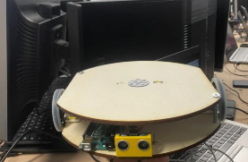
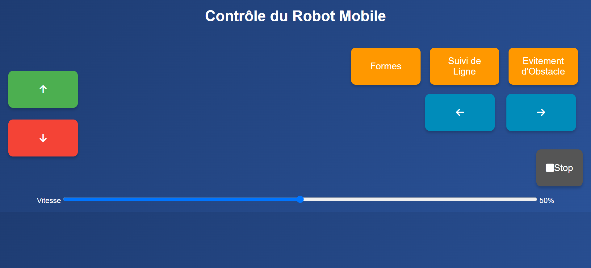

# Servotron — robot mobile autonome

Robot mobile à deux roues conçu à JUNIA (ESP32, châssis en bois découpé au laser) : il trace des formes géométriques, suit une ligne, évite les obstacles et se pilote depuis une interface web.
Ce dépôt contient la **simulation Webots** du robot et le **programme du robot réel**.

<!-- Vidéo : glisser media/servotron_simulation.mp4 ici depuis l'éditeur GitHub pour l'afficher en lecture directe -->
▶️ [Voir la vidéo de la simulation](media/servotron_simulation.mp4)

| Robot réel | Interface de pilotage (IHM) |
|---|---|
|  |  |

---

## Fonctionnalités

Le robot exécute uniquement les commandes de son IHM :

| Commande | Fonctionnement |
|---|---|
| **Flèches / Stop / Vitesse** | Pilotage manuel tant que le bouton est maintenu |
| **Formes** (cercle, carré, triangle) | Enchaînement de segments : lignes droites régulées en cap (PD), rotations sur place, arc de cercle |
| **Suivi de ligne** | 3 capteurs infrarouges au sol, régulation PD sur la position de la ligne |
| **Évitement d'obstacle** | Ultrason HC-SR04 + capteurs IR, machine à états (avance → recul → rotation) |

## Simulation Webots

Réplique du Servotron (plateaux, roues, HC-SR04, capteurs de ligne, stylo traceur) dans une arène de 5 m × 5 m comprenant une piste de suivi de ligne, une zone de dessin et un enclos d'obstacles.

**Résultats mesurés en simulation**

| Démonstration | Résultat |
|---|---|
| Carré (60 cm) | se referme à **2 mm** près |
| Triangle (70 cm) | se referme à **2 mm** près |
| Cercle (rayon 35 cm) | se referme à 4 cm près |
| Suivi de ligne | plus d'un tour de piste (virage en S compris), ligne jamais perdue |
| Évitement | exploration de l'enclos sans blocage |

**Calibration de l'odométrie** — les premiers essais finissaient chaque forme avec 24° d'écart de cap. Un tour complet commandé (360°) ne donnait que 336° réels : les pneus portent sur leur bord extérieur, l'écartement effectif des roues est donc de 32,6 cm et non 30,4 cm. Après calibration, l'erreur de fermeture passe de ~18 cm à 2 mm.

**Lancer la simulation** (Webots R2025a)
1. Ouvrir `simulation/worlds/servotron_arena.wbt`.
2. Compiler le contrôleur si nécessaire : ouvrir `servotron.cpp` dans l'éditeur de Webots puis *Build*.
3. Clic droit sur le robot → **Show Robot Window** pour afficher l'IHM.

## Robot réel (ESP32)

`robot/Servotron/Servotron.ino` — programme Arduino pour l'ESP32 :
- le robot crée son propre Wi-Fi (`SERVOTRON`) et sert l'IHM à l'adresse `http://192.168.4.1` ;
- boucle non bloquante (pas de `delay()`), l'IHM reste réactive pendant chaque démonstration ;
- câblage et constantes de calibration regroupés en tête de fichier.

Le robot réel n'a pas d'encodeurs : les formes y sont réalisées par temporisation et doivent être calibrées (`MS_PER_CM`, `MS_PER_DEGREE`).

| Composant | Broches ESP32 |
|---|---|
| Moteur gauche (PWM / DIR) | 13 / 12 |
| Moteur droit (PWM / DIR) | 14 / 27 |
| Capteurs de ligne (G / C / D) | 22 / 21 / 19 |
| HC-SR04 (TRIG / ECHO) | 5 / 4 |

## Structure du dépôt

```
simulation/
  worlds/servotron_arena.wbt          arène + modèle du robot
  controllers/servotron/servotron.cpp contrôleur C++
  plugins/robot_windows/              IHM de la simulation
robot/Servotron/Servotron.ino         programme du robot réel (ESP32)
media/                                vidéo et images
```

## Technologies

C++ · ESP32 (Arduino) · Webots · régulation PD · odométrie · HTML/CSS/JavaScript · SolidWorks · découpe laser

---

### English summary

Servotron is a two-wheeled mobile robot (ESP32) that draws shapes, follows a line, avoids obstacles and is driven from a web interface. This repository contains its Webots simulation (C++ controller, calibrated odometry, PD control — shapes close within 2 mm) and the Arduino program for the real robot.

**Auteur** : Manuel Parker NGOUNOU — [LinkedIn](https://linkedin.com/in/manuel-parker-ngounou-tayou)
